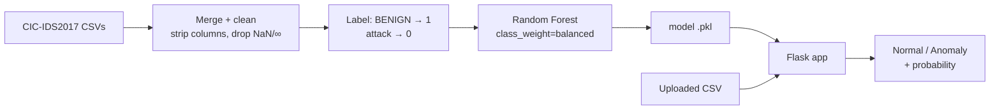

<div align="center">

# 🚨 DNS Anomaly Detection

**A machine-learning intrusion detector that labels network and DNS flows as benign or anomalous, served through a Flask web app.**


</div>

---

## 📌 Overview

Attacks such as **DDoS, port scans and botnets** leave statistical traces in flow features. This project trains a class-balanced **Random Forest** on the **CIC-IDS2017** dataset and wraps it in a web app: upload a CSV of flows and see which ones are anomalous, with confidence scores.

## 🏗️ Pipeline



## ✨ Features

- Loads and merges multiple CSVs into one training set
- Robust cleaning of infinities, NaNs and whitespace in column names
- Binary benign-vs-anomaly classification with a classification report
- Web UI: upload a CSV, then view predictions and the anomaly probability for each sampled flow

## 📂 Dataset

[CIC-IDS2017 on Kaggle](https://www.kaggle.com/datasets/chethuhn/network-intrusion-dataset): real traffic with benign and attack scenarios.

## 🚀 Run

```bash
git clone https://github.com/Ghanasree-S/DNS_Anomaly_Detection.git
cd DNS_Anomaly_Detection
pip install -r requirements.txt
python train.py        # point glob in train.py at your dataset folder
python app.py          # http://127.0.0.1:5000
```

## 🌐 Endpoints

| Endpoint | Method | Description |
|---|---|---|
| `/` | GET | Upload page |
| `/upload` | POST | Run predictions on an uploaded CSV |

## 👩‍💻 Author

**Ghanasree S**: [GitHub](https://github.com/Ghanasree-S) · [LinkedIn](https://www.linkedin.com/in/ghanasree-s-88976b2b0)
